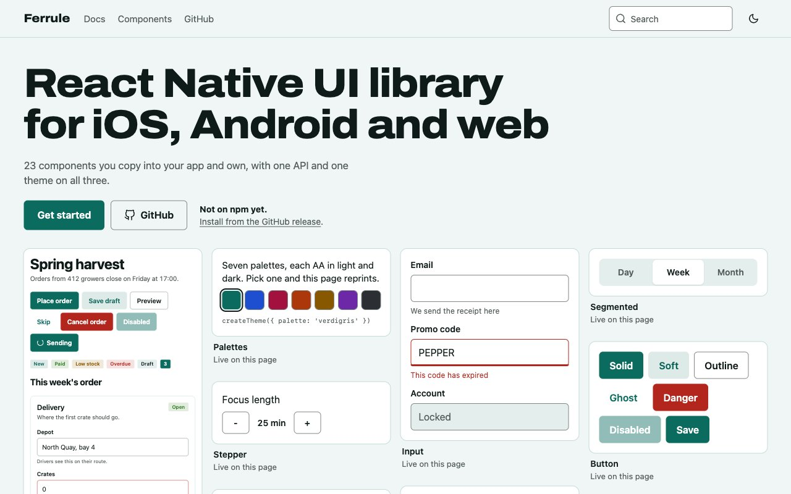

<p align="center">
  
</p>

<h1 align="center">Ferrule</h1>

<p align="center">
  <strong>React Native UI components for iOS, Android and web.</strong><br>
  You copy them into your app and own them. Change one word and the whole product reprints.
</p>

<p align="center">
  <a href="https://leoanimesh.github.io/ferrule/"><strong>Website</strong></a> ·
  <a href="https://leoanimesh.github.io/ferrule/docs/getting-started">Docs</a> ·
  <a href="https://github.com/leoAnimesh/ferrule/releases/latest">Releases</a> ·
  <a href="CONTRIBUTING.md">Contributing</a>
</p>

<p align="center">
  <a href="https://github.com/leoAnimesh/ferrule/actions/workflows/ci.yml"></a>
  <a href="https://github.com/leoAnimesh/ferrule/releases/latest"></a>
  
  <a href="LICENSE"></a>
</p>

## Install

**Ferrule is not on npm yet.** Install it from the tarball attached to the [GitHub release](https://github.com/leoAnimesh/ferrule/releases/latest). It holds only the package, not the example app or the docs site. Requires React Native 0.86 or later on the New Architecture, React 19, Node 20 or later for the CLI, and `react-native-reanimated` 4.7 with `react-native-worklets` 0.13.

```sh
# Expo
npx expo install react-native-reanimated react-native-worklets
npm install https://github.com/leoAnimesh/ferrule/releases/download/v0.1.0/ferrule-0.1.0.tgz

# Bare React Native
npm install react-native-reanimated react-native-worklets
npm install https://github.com/leoAnimesh/ferrule/releases/download/v0.1.0/ferrule-0.1.0.tgz
cd ios && pod install && cd ..

# Both
npx ferrule init --fix        # writes ferrule.json and ferrule.theme.ts, and adds the Babel plugin
npx ferrule add button input  # copies components/ui/*.tsx, with what they depend on
```

The component registry ships inside the package and `add` reads it locally, so nothing else is fetched. For web, also install `react-native-web` and `react-dom`. A plain git dependency does not work, because the package lives in a subdirectory of this repo.

## Quick start

Wrap your app once:

```tsx
import { FerruleProvider } from 'ferrule';
import { theme } from './ferrule.theme';
import { Screen } from './Screen';

export default function App() {
  return (
    <FerruleProvider theme={theme}>
      <Screen />
    </FerruleProvider>
  );
}
```

Then use what you added:

```tsx
import { useState } from 'react';
import { View } from 'ferrule';
import { Button } from './components/ui/button';
import { Input } from './components/ui/input';

export function Screen() {
  const [email, setEmail] = useState('');
  return (
    <View style={{ gap: 12, padding: 16 }}>
      <Input label="Email" value={email} onChangeText={setEmail} />
      <Button onPress={() => console.log(email)}>Save</Button>
    </View>
  );
}
```

## What it does

- **Yours.** `ferrule add button` copies the source into your project. Edit anything. There are 23 components.
- **Consistent.** Controls are drawn in JS instead of wrapping platform widgets, so a switch is the same size and shape everywhere. A [script](#consistency) measures every component on each platform and compares them.
- **Accessible.** Roles, names, states, keyboard and focus handling, 44dp touch targets, font scaling, reduced motion and right-to-left are built in.
- **Icons included.** All 287 [Feather](https://feathericons.com) icons, typed by name, drawn in JS with no icon font or SVG library. Native variants keep their system icons.
- **No lock-in.** It works in bare React Native and Expo with no Expo dependency, and needs no font install. `react-native-reanimated` is the one required native dependency.

## Theming

Every theme is one ink printed on paper tinted by that same ink. The default is verdigris, the patina a brass ferrule grows.

```ts
import { createTheme } from 'ferrule';

export const theme = createTheme({ palette: 'cobalt' });
```

Palettes are `verdigris`, `cobalt`, `madder`, `vermilion`, `saffron`, `plum` and `graphite`, or your own from one color, each checked against WCAG AA in light and dark. Tokens, per-component slots, variants and fonts go through [one system](https://leoanimesh.github.io/ferrule/docs/theming).

## Native variants

The optional `ferrule-native` package draws real platform views: SwiftUI and UIKit on iOS, including Liquid Glass on iOS 26+, and Jetpack Compose Material 3 on Android. Add `native` to a component. Anywhere the view cannot draw (web, Expo Go, an older OS) you get the Ferrule component.

```sh
npm install https://github.com/leoAnimesh/ferrule/releases/download/v0.1.0/ferrule-native-0.1.0.tgz
```

```tsx
import 'ferrule-native';

<Button native onPress={save}>Save</Button>;
```

See [native variants](https://leoanimesh.github.io/ferrule/docs/native) and the [coverage table](packages/ferrule-native/docs/coverage.md), which says what was run on each platform and what has not been built.

## Platforms

| Platform | Status | How it was checked |
| --- | --- | --- |
| iOS | Verified | Ran on an iOS 26.5 simulator (iPhone 17 Pro Max): XCUITest suite, screenshots, large text, RTL, reduced motion. Both the example app and a fresh bare app. A fresh Expo app installed from the release tarball also ran here, with a native button. |
| Android | Verified | Ran on an API 37 emulator: scripted flow with real taps and hardware back, screenshots, font scale 2, RTL, reduced motion. A fresh Expo app installed from the release tarball also ran here, with a native button. A fresh bare app was only bundled for Android, not run. |
| Web | Verified | `react-native-web` in Chrome: keyboard, focus trap, Escape, RTL, reduced motion, plus a fresh Expo web export. |

Physical devices have not been tested. An iPad mini simulator was checked for layout and safe area only. Status reflects versions read on 2026-11-06.

Ferrule targets iOS, Android and web. Other platforms are out of scope.

`ferrule-native` has its own, narrower status: iOS 26.5 simulator and API 37 emulator only, no physical device, and iOS below 26 not run. See its [coverage table](packages/ferrule-native/docs/coverage.md).


## CLI

| Command | What it does |
| --- | --- |
| `ferrule init [--dir components/ui] [--palette cobalt] [--fix]` | Writes `ferrule.json` and a theme file into an existing project, and checks the Reanimated setup. Never overwrites. `--fix` adds the Babel plugin |
| `ferrule add <names...>` | Copies components and their dependencies. Keeps your edits unless you pass `--overwrite` |
| `ferrule add --all` | Copies every component |
| `ferrule list` | Lists components |
| `ferrule check` | Exits 1 if primitives (`View`, `Text`, ...) come directly from `react-native`, so they all pick up theming and consistency fixes, if a copied component holds a raw color, or if Reanimated is misconfigured. APIs Ferrule does not cover, such as `Linking`, stay allowed |

The registry ships inside the package and is read locally, so `add` works offline and matches your installed version.


## Consistency

The harness (`apps/example`) has a `metrics` screen that renders each component in a fixed 320dp column and logs its measured size. `scripts/compare-metrics.mjs` compares the logs and fails on any difference over 1dp.

Last run with the same font on iOS, Android and web: 27 of 30 probes within 1dp, all within 1.4dp. The three over 1dp are widths of text that hugs its content (`button.lg`, `text.caption.hug`, `text.h1.hug`), where each platform's text engine rounds tracking differently. No layout changes because of them, and the script still reports them, on purpose.

`compare-metrics.mjs` still exits 1 at its default 1dp tolerance because of those three probes. They are not hidden behind a wider tolerance.

Native variants (`native` prop, `ferrule-native`) are deliberately outside this comparison: they look like the platform, not like each other. The metrics screen forces `native={false}`.

Differences that are deliberate:

- **The default font is each platform's system font**, so no install is needed. Text widths match only when you load one font on all platforms. See [theming](packages/ferrule/docs/theming.md#identical-text-on-every-platform). Glyph rendering still differs slightly by OS.
- **Hover** appears only where a pointer exists. **Focus rings** appear for keyboard focus, not touch or mouse clicks.
- **Screen readers** behave as each platform does: VoiceOver, TalkBack and browser ones phrase things differently.
- **Right-to-left** is live on web, and needs a restart on iOS and Android, because React Native fixes it per process.


## Known limits

- **React Native 0.86 is the floor**, set by Reanimated 4.7. Older apps cannot use Ferrule.
- **Safe area** is estimated without a native dependency. On edge-to-edge Android, pass real `insets` to `FerruleProvider`.
- **Overlays use React Native's `Modal`.** That brings OS focus handling, but iOS cannot show two sibling modals at once, so render a sheet inside the modal that opens it.
- **Toasts sit at the bottom**, above everything, so one can cover a bottom sheet's controls until it times out or is dismissed.
- **Android API 36 and later** ask debug builds for local network access on first launch, to reach Metro. Allow it, or the app shows "Unable to load script".
- **`check` scans with patterns**, not a full parser, so unusual import forms can slip past it.

## FAQ

**Is it on npm?**
No. Install from the release tarball, as above. `npm install ferrule` will not get you this project.

**Do I have to use Expo?**
No. It works in bare React Native and Expo. Native variants need a development build, because Expo Go cannot load custom native code.

**Will updating overwrite my edits?**
No. `add` keeps your copy unless you pass `--overwrite`.

**Does the bottom tab bar have Liquid Glass?**
Not on iOS as hosted today: `TabBar` with `native` is a real `UITabBar` with no Ferrule styling, and it paints no glass material of its own. Glass is on `IconButton`, `Button` and `Card`.

## More

- [Docs site](https://leoanimesh.github.io/ferrule/): every component with a live preview, its props and accessibility notes.
- [Contributing](CONTRIBUTING.md): set up the repo, add a component, add a native view. Agent skills for this are in [`.claude/skills`](.claude/skills).
- `apps/example` is the test harness, a catalog of every component. It is not part of the installed package.

## License

MIT. See [LICENSE](LICENSE).

## Credits

- Icons are [Feather](https://github.com/feathericons/feather) 4.29.2 by Cole Bemis, MIT. The license is in [`packages/ferrule/LICENSE-feather`](packages/ferrule/LICENSE-feather) and ships in the package.
- Harness and docs sample images are generated by `apps/example/scripts/gen-sample.mjs`.
- The harness loads Inter, Lora, Caveat and Space Mono from `@expo-google-fonts`, and the docs site uses Archivo from `@fontsource-variable/archivo`, all under the SIL Open Font License. None of them ships in the `ferrule` or `ferrule-native` packages.
- The docs site's structure took cues from shadcn/ui, Radix, Tamagui, gluestack and React Native Paper. No text, code or design was copied.
